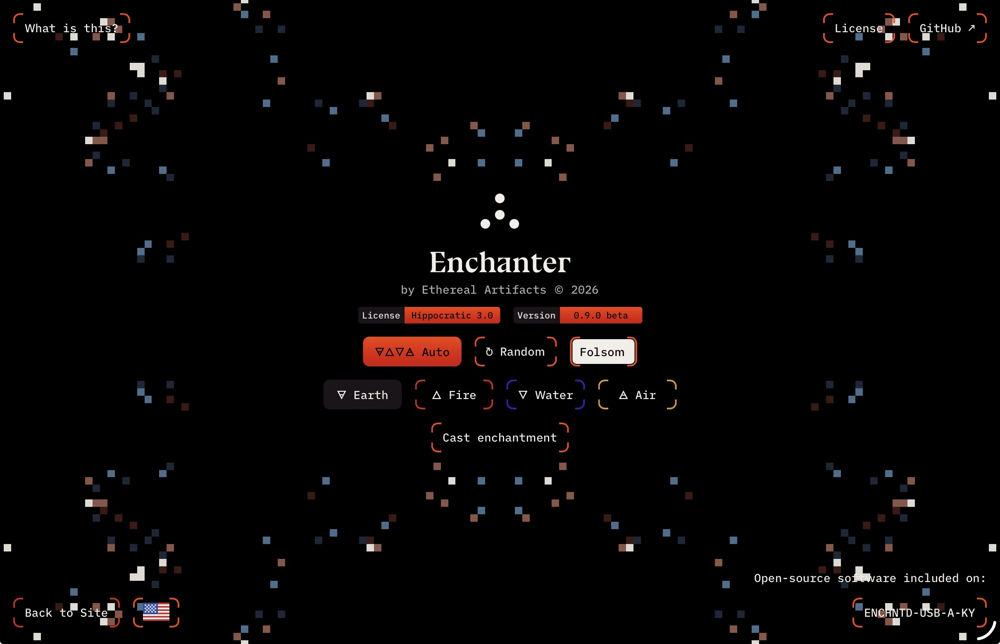
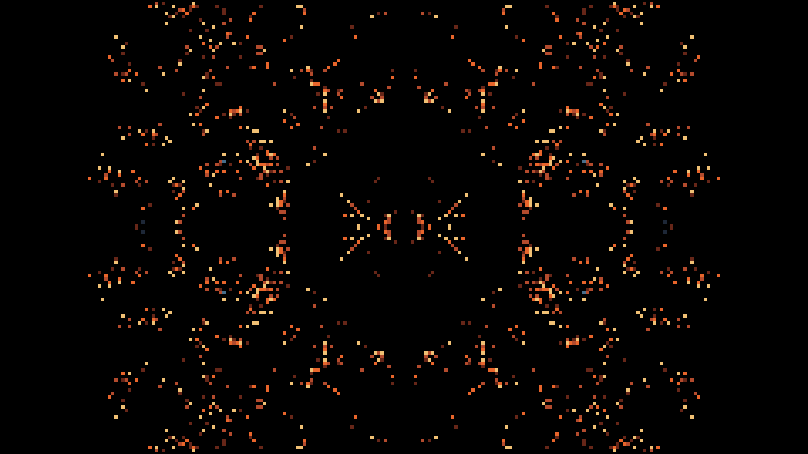
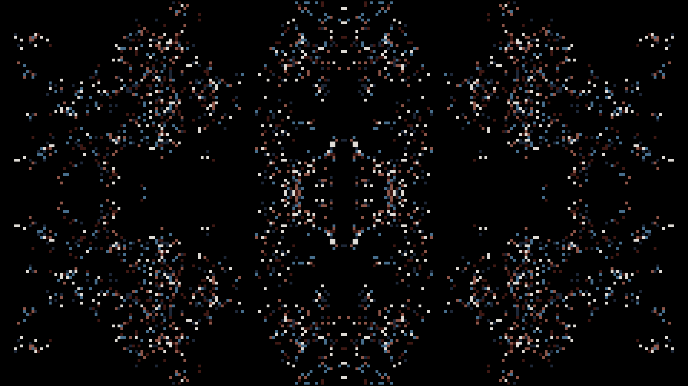
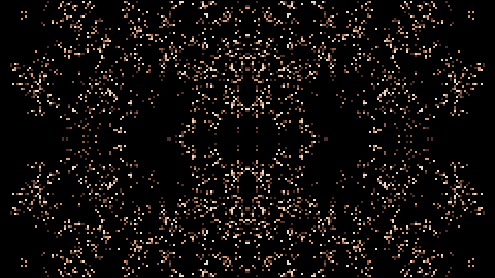
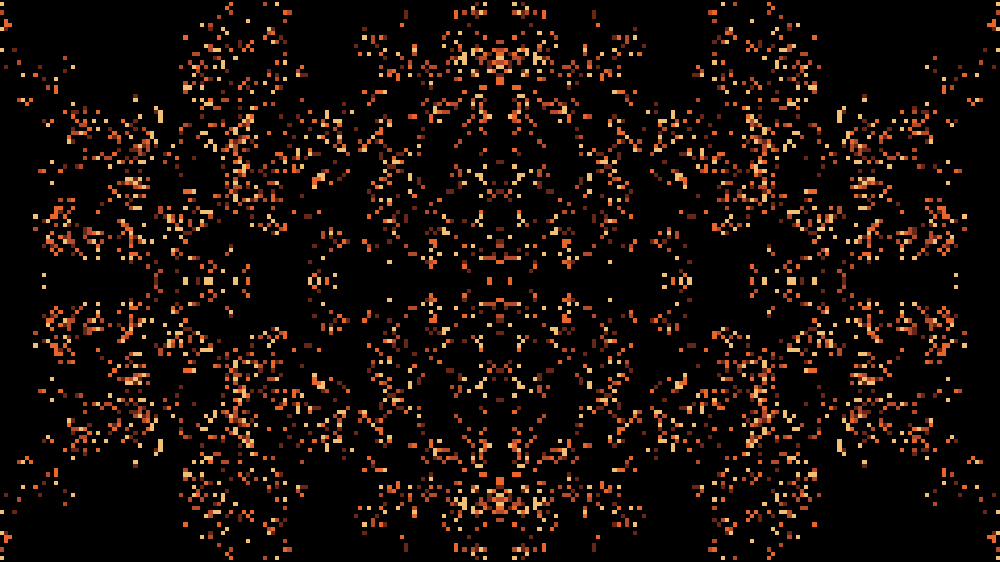

# Enchanter

**Beautiful visuals. Instant atmosphere.**



Enchanter is a free, lightweight visualizer by Ethereal Artifacts, made to bring a little atmosphere wherever you need it.

Open it in a browser, connect it to a projector, or run it on a Raspberry Pi. Use it at home, at a party, in a warehouse, or somewhere it probably wasn’t meant to go.

Choose an Element, let the visuals cycle on their own, or play with the settings.

<p>
  
  
</p>
<p>
  
  
</p>

## How It Works

### Open the Grimoire

The Grimoire is Enchanter’s book of spells. Explore its existing schools of elemental magic, or learn more about **Spellcraft** to begin designing your own spells.

### Call Upon the Sound of the Echo

Each **Echo** is inspired by the magic of the Bay. It gives rise to patterns you can shape through elemental magic and cast into a new space.

The Grimoire begins with eight Echoes:

- Folsom
- Palace of Fine Arts
- Tenderloin
- Sutro Baths
- Battery Davis
- Jingletown
- Bayview
- Fort Funston

### Choose Your Element

**Earth 🜃, Fire 🜂, Water 🜄, and Air 🜁** each modulate your chosen Echo, giving its patterns a different expression.

Every Element draws upon a **Reagent**, a map of colors that determines its palette. Together, your Echo and its elemental modulation form a **Spell**—the complete effect you cast into your space.

Choose an Element to stay with its colors. Choose **Auto** to cycle through all four, or **Random** to move between their palettes at changing intervals.

You can change Elements without changing your Echo.

## Cast Your First Spell

1. Select **Code → Download ZIP** on this GitHub page.
2. Unzip the download, then double-click **`enchanter.html`** in the top-level folder.
3. Choose an Echo from the **Echo of** menu.
4. Choose an Element, or start with **Auto**.
5. Press **Cast enchantment**.

Go fullscreen, connect a projector, or leave it playing on your screen.

The finished file works offline. Keep it on your computer or a USB drive and open it in a modern browser. No installation, account, server, or Node.js required.

The download includes both the ready-to-open HTML file and the source. You only need the HTML file to run Enchanter. Keep the license and third-party notices with any copies you share.

## While You’re Enchanting

**Pause** holds the moment. **Resume** lets it continue.

**Fullscreen** fills your display. **Snapshot** saves a single frame as a picture.

**End** finishes the enchantment.

Fullscreen and snapshots depend on your browser. Performance varies with your device and display size.

## Language and Accessibility

Ethereal Artifacts prides itself in rendering adaptive interfaces across all orientations of human writing and communication.

Our approach encompasses four writing orientations:

- **English:** horizontal, read from left to right.
- **Arabic:** horizontal, read from right to left.
- **Japanese tategaki:** read from top to bottom, with columns progressing from right to left.
- **Traditional Mongolian script:** read from top to bottom, with columns progressing from left to right.

Enchanter’s controls and information are available in English and 72 other language versions, with right-to-left layouts for Arabic, Persian, Urdu, and Pashto.

Echo names and license terms remain in English. The [language guide](docs/localization.md) contains the full list.

## Spellcraft

Start with one color.

Every Element consumes a Reagent—a source map of colors used to modulate an Echo. Earth, Fire, Water, and Air each have their own Reagent, but their colors aren’t fixed. Change a Reagent, and you change how its Element expresses itself without changing the Echo.

The [first-change guide](docs/first-change.md) shows you where to find the Earth Reagent, how to change a color, and how to see the result. Then it introduces a small function that makes the colors brighter.

Every step includes a way back. Experiment, cast again, and see what happens.

If you’d like to create your own elemental magic, explore [alchemical glyphs on Wikipedia](https://en.wikipedia.org/wiki/Alchemical_symbol) for inspiration.

You’re welcome to fork Enchanter—make your own copy and keep your discoveries there. We aren’t accepting contributions or pull requests to the main project right now.

### Working with the Source

**To use Enchanter**, open the finished HTML file.

**To change Enchanter**, edit the source and build a new HTML file. Node.js runs the build tools; your browser runs the finished Enchanter.

With Node.js 20.19 or newer installed, open a terminal in the source folder and run:

```sh
npm ci
npm run build
```

The build updates the ready-to-open file at the top level of the repository:

```text
enchanter.html
```

Rebuild after each change, then reopen that file. You can copy the finished file to another computer without installing Node.js there.

The accompanying guides cover [your first change](docs/first-change.md), [building](docs/build.md), [the Grimoire’s structure, and the engine beneath it](docs/package-and-architecture.md).

## Share It with Care

Enchanter is available under the [Hippocratic License 3.0 core](LICENSE), with ethical-use conditions.

Keep the license and [third-party notices](THIRD_PARTY_NOTICES.md) with copies you share. Bundled fonts retain their own licenses.

### License Addendum: the In-App Highlight

The app’s license highlight states:

> By using this software, you agree to not use Enchanter at events, exhibitions, gatherings, or raves that promote or tolerate discrimination.

Enchanter must not be used in spaces that promote or tolerate racism, sexism, homophobia, transphobia, ableism, or discrimination based on ethnicity, nationality, religion, caste, or age.

It cites **Hippocratic License 3.0, Section 3.1.5**, including the following passage:

> “Discriminate on the basis of sex, gender, sexual orientation, race, ethnicity, nationality, religion, caste, age, medical disability or impairment, and/or any other like circumstances”

**PLURR — Peace, Love, Unity, Respect, Responsibility.**

This addendum carries the in-app highlight into the documentation. It does not amend the [license](LICENSE), which remains the governing text.

---

Dedicated to those who make others *feel*.

See you in the Rave.
